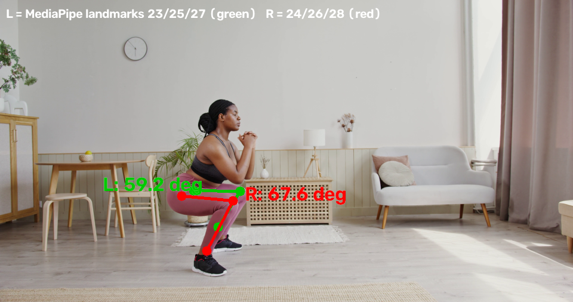

# Backend testing and evidence

Everything here was run on Windows with Python 3.11 against `backend/sample.mp4` (4096×2160, 25 fps, 29.7 s side-view squat video, see the README for the source).

## How to run the tests

```powershell
cd backend
.\venv\Scripts\python.exe -m pip install -r requirements.txt
.\venv\Scripts\python.exe -m pytest -v
```

- No server needs to be running; the API tests use FastAPI's `TestClient`.
- Test videos (black, upper-body-only, random bytes, short clip) are generated by the tests into `tests/fixtures/` (git-ignored).
- Tests that need `sample.mp4` are skipped cleanly when it is missing (15 passed, 5 skipped without it).
- `pytest.ini` limits collection to `tests/` because `test_local.py` in the backend root is a script, not a test.
- Full output of the last run: [`evidence/pytest_results.txt`](evidence/pytest_results.txt) (20 passed, about 30 s).

## Test cases

| # | Input | Expected | Actual | Result |
| --- | --- | --- | --- | --- |
| 1 | `joint_angle` hip/knee/ankle at a right angle | 90° | 90° | pass |
| 2 | `joint_angle` collinear points | 180° | 180° | pass |
| 3 | `joint_angle` coincident points | 0°, no crash | 0.0, no crash | pass |
| 4 | `joint_angle` arms 60° apart | 60° | 60° | pass |
| 5 | `joint_angle` same angle, different segment length | 90° (length-independent) | 90° | pass |
| 6 | `GET /health` | 200, `{"status":"ok"}` | as expected | pass |
| 7 | `POST /analyze` with `sample.mp4` | `status: ok`, all 8 contract fields, `unit: degrees`, `metric: knee_flexion_angle`, angles numeric or null, `frames_with_pose <= frames_analyzed` | as expected | pass |
| 8 | Same response, key order | `status, movement, metric, unit, left_knee_min_angle, right_knee_min_angle, frames_analyzed, frames_with_pose` | as expected | pass |
| 9 | `/analyze` without `movement` | `movement: "squat"` | `"squat"` | pass |
| 10 | `/analyze` with `movement=drop-jump` (2 s clip of the sample) | `movement: "drop-jump"` echoed | `"drop-jump"` | pass |
| 11 | Black video (generated, 2 s) | `no_pose_detected` | `no_pose_detected` | pass |
| 12 | Upper body only (top 45% of each frame of the sample, 4 s) | `legs_not_visible` | `legs_not_visible` | pass |
| 13 | 4 KB of random bytes saved as `.mp4` | `cannot_open_video` | `cannot_open_video` | pass |
| 14 | `analyze_video` monkeypatched to raise | `processing_failed`, HTTP 200 | as expected | pass |
| 15 | `/analyze` with no `file` field | HTTP 422 (see note below) | 422, `loc: ["body","file"]` | pass |
| 16 | Temp upload file after a request | deleted | deleted | pass |
| 17 | Fake landmarker, right leg visibility 0.1 | right angle `null` (not 0), left ≈ 90° | `null`, 90° | pass |
| 18 | Fake landmarker, both legs visible | both ≈ 90° | 90°, 90° | pass |
| 19 | Downscale a 4096×2160 frame | longer side 960, same aspect ratio | 960×506 | pass |
| 20 | Downscale a 640×480 frame | unchanged | unchanged | pass |

**422 note:** a request with no `file` field returns FastAPI's default validation error (`{"detail": [...]}`), not the `{"status": "error", ...}` JSON. This is documented, not changed. The frontend always sends `file`, and it shows "Analysis failed" for any non-2xx response.

## Sample video results

`POST /analyze` with `sample.mp4`, after the 960 px downscale:

| Field | Value |
| --- | --- |
| `left_knee_min_angle` | 59.2° |
| `right_knee_min_angle` | 65.8° |
| `frames_analyzed` | 188 |
| `frames_with_pose` | 188 |
| Processing time | about 13–15 s (was 35–38 s before the downscale; angles changed by 0.2° and 0.3°) |

**Frame count check:** the video is 743 frames at 25 fps (29.72 s). Only the first 15 s are used and every 2nd frame is analyzed: 15 × 25 / 2 = 187.5, and the backend analyzed 188. This matches.

Source: [`evidence/frame_stats.txt`](evidence/frame_stats.txt).

## Left/right check



Made by `scripts/left_right_check.py` (frame at t = 2.88 s, the deepest bend in the video). Green is the left leg (MediaPipe landmarks 23/25/27), red is the right leg (24/26/28).

- **Which side is "left"?** MediaPipe's left/right means the *person's own* left and right, not the left/right of the image. This is MediaPipe's documented convention, and the image agrees with it:
  - The person faces image-right (nose is right of the hips) and the video is not mirrored, so their right side is the one nearest the camera.
  - The red (R) leg is the clearly visible near leg: mean visibility 0.98, never null.
  - The green (L) leg is the far leg, mostly hidden behind the near one: mean visibility 0.74, and its angle is `null` in 53 of 188 frames.
- **Angles in this frame:** left 59.2°, right 67.6°. The right angle in the final result (65.8°) is the minimum over all frames, which occurs in a different frame than this one.
- **Limits of this check:** it is one video, and it relies on the video not being mirrored. A mirrored recording (some front-camera modes) would swap left and right, so prefer the back camera.

**Occluded leg gives `null`, not 0:** shown two ways. In the sample, the far leg is `null` in individual frames and those frames are skipped (the minimum comes from the remaining 135 frames). Test 17 checks the case where a leg is never visible: the result is `null`, never 0.

## Frontend contract check

Checked live against the frontend's `screening.ts` validator (`validateScreeningResponse`):

- A real success response from `/analyze` is accepted as a successful measurement (movement, metric, unit, both angles, frame counts all parsed).
- A real `cannot_open_video` response is mapped to "Unable to read this video. Please select or record another video."
- All four error codes the backend can return (`cannot_open_video`, `no_pose_detected`, `legs_not_visible`, `processing_failed`) have a message in the frontend's `ERROR_MESSAGES`.
- Not run: the frontend's own test suite (`npm test`), because `frontend/node_modules` was not installed. No live test from a phone through the app has been done yet.

## Known limitations

- **Single camera, no depth:** angles are computed from 2D image positions. Camera angle and distance change the result, so values are not clinical measurements. Side view is assumed for squats.
- **15 s cap:** only the first 15 s of a video are analyzed.
- **Far-leg occlusion:** in a side view the far leg is partly hidden, so its angle may be `null` or less reliable.
- **Movement is not used:** `movement` is echoed back, but only knee angle is measured for every movement type.
- **API URL depends on the laptop's LAN IP:** it is hardcoded in `frontend/src/constants/config.ts` and must be updated when the network changes.
- **Angle convention:** the backend reports the interior angle at the knee, where 180° = straight leg. Clinical knee flexion = 180° − the reported angle. A smaller reported angle means a deeper bend.
